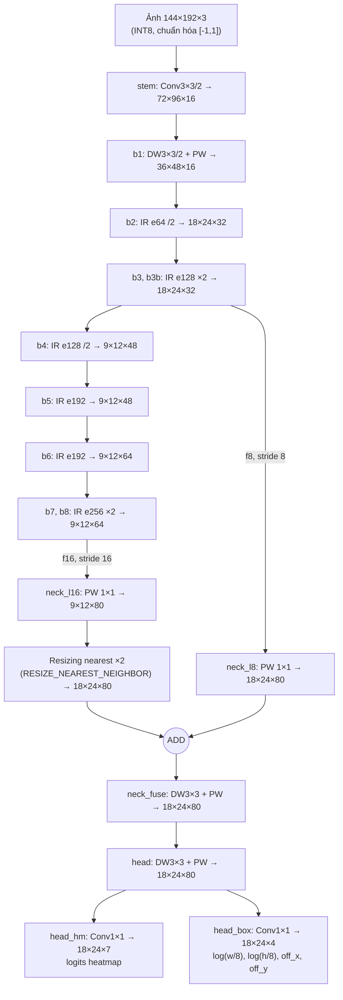
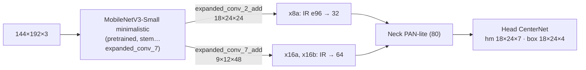

# D4 – Sơ đồ kiến trúc EdgeDet và bảng phân bổ params

Mã nguồn: `src/edgedet/models/edgedet.py`. Shape dưới đây ứng với input **144×192** (4:3, cùng tỉ lệ ảnh nguồn 320×240).

## 1. Sơ đồ tổng thể (H1-C: backbone tự thiết kế + head CenterNet)

`IR eN` = inverted residual: Conv1×1 (expand N kênh) → DW3×3 → Conv1×1 tuyến tính, có skip ADD khi stride 1 và số kênh vào bằng số kênh ra. Kích hoạt **ReLU6**; không dùng SE, không h-swish.

## 2. Các biến thể

| Mã | Backbone | Head | Khác H1-C ở đâu |
|---|---|---|---|
| **H1-C** | custom (bảng trên) | CenterNet (hm 7 + box 4) | – |
| **H1-P** | MobileNetV3-Small minimalistic α=1.0 đến `expanded_conv_7_add` (pretrained ImageNet), cộng khối thêm `x8a` (IR e96→32) ở stride 8 và `x16a`, `x16b` (IR e192/e256→64) ở stride 16 | CenterNet | Thay toàn bộ b1–b8 |
| **H2** | như H1-C (hoặc H1-P) | YOLO anchor: Conv1×1 → 3×(5+7) = 36 kênh ở stride 8 | Chỉ thay `head_hm`/`head_box` bằng `head_out` |

Sơ đồ H1-P:

## 3. Bảng phân bổ params (input 144×192) [TĐ]

| Biến thể | Params (Keras, gồm BN) | Sau gộp BN (.tflite) | Còn trống so với 200K | MACs | Bảng chi tiết từng layer |
|---|---|---|---|---|---|
| H1-C (center) | **185.307** | 174.507 | 14.693 | 37,7M | [param_table_edgedet_c_center_144x192.md](param_table_edgedet_c_center_144x192.md) |
| H1-P (center) | **189.379** | 177.259 | 10.621 | 35,1M | [param_table_edgedet_p_center_144x192.md](param_table_edgedet_p_center_144x192.md) |
| H2-C (yolo) | **187.332** | 176.532 | 12.668 | 38,5M | [param_table_edgedet_c_yolo_144x192.md](param_table_edgedet_c_yolo_144x192.md) |
| H2-P (yolo) | **191.404** | 179.284 | 8.596 | 35,9M | [param_table_edgedet_p_yolo_144x192.md](param_table_edgedet_p_yolo_144x192.md) |

Số params **không đổi theo độ phân giải input**. Đã kiểm chứng ở 96×128, 144×192, 192×256 và 240×320.

Phân bổ của H1-C theo khối: backbone 86,7% (đến stride 8: 26.304 = 14,2%; stride 16: 134.272 = 72,5%), neck 16.080 (8,7%), head 8.651 (4,7%).

Cách đếm: "Params (Keras)" là `model.count_params()`, gồm cả 4 tham số BatchNorm mỗi kênh (γ, β, mean, var). Khi convert, BN được gộp vào conv, nên số hằng số thực trong `.tflite` là cột "Sau gộp BN". Đội báo cáo **số lớn hơn (Keras)** để chắc chắn tuân thủ giới hạn 200K dù BTC đếm theo cách nào.

Tái tạo: `.venv/Scripts/python scripts/analysis/phase2_export.py`. Script `assert` mọi biến thể ≤ 200.000.
